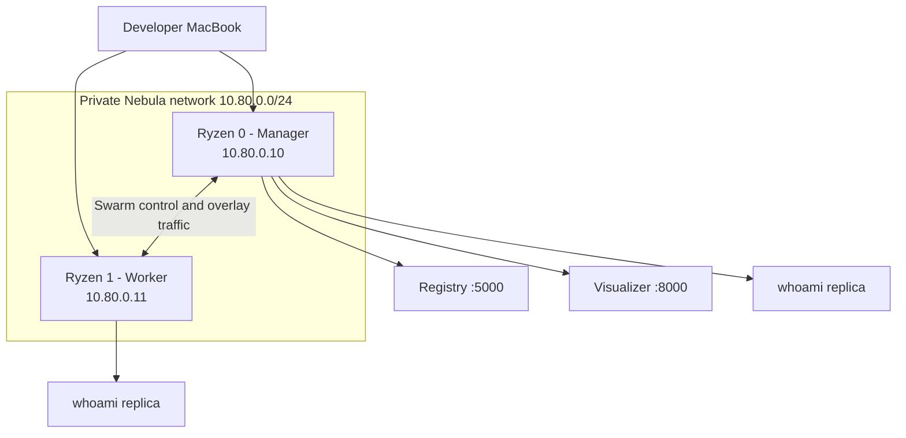

# CS371 Cloud Infrastructure — Docker Swarm

**Project:** Pace University CS371
**Path:** `docs/cloud-infra.md`
**Last updated:** November 3, 2026

## 1. Purpose and architecture

This document records the two-node Docker Swarm environment configured for the CS371 project. It covers the manager, worker, Nebula networking, Registry, Visualizer, firewall hooks, and a two-replica test application.

### Node inventory

| Role | Hostname | Nebula IP | LAN IP observed |
|---|---|---|---|
| Manager (Ryzen 0) | `cs371-bc9b0c` | `10.80.0.10` | `192.168.4.30` |
| Worker (Ryzen 1) | `cs371-bc9a92` | `10.80.0.11` | `192.168.1.174` |

Docker Engine `29.1.3` was reported on both nodes. The Linux account is `milkalmond` on Ryzen 0 and `twix` on Ryzen 1.



### Required network ports

| Port | Protocol | Purpose |
|---:|---|---|
| 2377 | TCP | Swarm manager/control-plane communication |
| 7946 | TCP/UDP | Swarm node discovery and gossip |
| 4789 | UDP | Swarm overlay VXLAN data path |
| 5000 | TCP | Private Docker Registry |
| 8000 | TCP | Docker Swarm Visualizer |
| 8081 | TCP | Test application, published through Swarm ingress |

The Nebula identity `bayron` is used in host-specific access rules. Keep the Registry, Visualizer, and test application restricted to the intended private-network clients.

## 2. Verify Docker and Swarm readiness

Docker was already installed on both machines when this configuration work began. The exact package installation transcript was not retained, so this document does not assume which package source was used.

Run on each node:

```bash
docker --version
sudo systemctl status docker --no-pager
sudo docker info
```

On the manager, check the cluster summary:

```bash
docker info --format 'Swarm: {{.Swarm.LocalNodeState}} | Manager IP: {{.Swarm.NodeAddr}} | Managers: {{.Swarm.Managers}} | Nodes: {{.Swarm.Nodes}}'
```

Observed manager state:

```text
Swarm: active | Manager IP: 10.80.0.10 | Managers: 1 | Nodes: 2
```

## 3. Initialize the manager and join the worker

Ryzen 0 (`cs371-bc9b0c`) is the manager and leader. Its advertised Nebula address is `10.80.0.10`.

For a new cluster only, initialize the manager:

```bash
sudo docker swarm init --advertise-addr 10.80.0.10
```

Do not run `swarm init` again on a node already in a Swarm. Check first:

```bash
sudo docker info --format '{{.Swarm.LocalNodeState}}'
docker node ls
```

Generate a worker join command on the manager:

```bash
docker swarm join-token worker
```

Run the generated command on Ryzen 1. Its endpoint should be `10.80.0.10:2377`:

```bash
sudo docker swarm join --token <WORKER_JOIN_TOKEN> 10.80.0.10:2377
```

Replace the placeholder with the token generated by the manager. **Never commit a real join token, password, or private key to the repository.**

Verify membership on the manager:

```bash
docker node ls
```

Observed cluster:

| Hostname | Status | Availability | Manager status |
|---|---|---|---|
| `cs371-bc9b0c` | Ready | Active | Leader |
| `cs371-bc9a92` | Ready | Active | Worker |

## 4. Label the nodes

The nodes were labeled to identify their roles. Run on the manager:

```bash
docker node update --label-add cs371role=manager cs371-bc9b0c
docker node update --label-add cs371role=worker cs371-bc9a92
```

Inspect labels:

```bash
docker node inspect cs371-bc9b0c --format '{{.Description.Hostname}} {{json .Spec.Labels}}'
docker node inspect cs371-bc9a92 --format '{{.Description.Hostname}} {{json .Spec.Labels}}'
```

The test stack uses a `spread` placement preference based on `node.labels.cs371role`. This is a preference, not a hard placement constraint. Verify actual placement with `docker service ps`.

## 5. Nebula networking

Nebula provides the private mesh network. The observed addresses are:

- Ryzen 0: `10.80.0.10/24` on `tun0`
- Ryzen 1: `10.80.0.11/24` on `tun0`

Check the interface and service:

```bash
ip -4 addr show tun0
sudo systemctl status nebula --no-pager
sudo systemctl is-active nebula
```

Validate a configuration before applying it:

```bash
sudo nebula -config /etc/nebula/config.yml -test
```

**Important:** `nebula -test` validates the file; it does not apply changes to the running service. After a validated change, restart Nebula on the affected node:

```bash
sudo systemctl restart nebula
sudo systemctl is-active nebula
```

Restart one node at a time. An SSH session over Nebula may briefly disconnect; reconnect after the service is active.

### Swarm rules in Nebula

The manager's inbound policy includes these rules for the `servers` group:

```yaml
    - port: 7946
      proto: tcp
      group: servers
    - port: 7946
      proto: udp
      group: servers
    - port: 4789
      proto: udp
      group: servers
    - port: 2377
      proto: tcp
      group: servers
```

The manager also has host-specific TCP access for Nebula host `bayron` on ports 5000, 8000, and 8081.

The worker's observed inbound policy includes:

```yaml
  inbound:
    - port: any
      proto: icmp
      host: any
    - port: 22
      proto: tcp
      group: laptops
    - port: any
      proto: any
      group: servers
    - port: 8081
      proto: tcp
      host: bayron
```

The worker's broad `servers` rule is existing configuration. Review it with the team before narrowing it, because it can affect peer communication.

## 6. Private Docker Registry

A Registry v2 instance was running on Ryzen 0 using image `registry:2`. The observed Swarm service was:

```text
NAME       MODE         REPLICAS   IMAGE
registry   replicated   1/1        registry:2
```

The Registry API was verified from the MacBook over Nebula:

```bash
curl -i --max-time 10 http://10.80.0.10:5000/v2/
```

Expected successful response:

```text
HTTP/1.1 200 OK
Docker-Distribution-Api-Version: registry/2.0

{}
```

The exact original Registry creation command or stack file was not captured. Do not recreate the Registry blindly on an existing host; inspect the service/container and its storage configuration first.

## 7. Docker Swarm Visualizer

The Visualizer was run as a container on Ryzen 0 and bound to its Nebula IP:

```bash
docker pull dockersamples/visualizer:stable

docker run -d \
  --name visualizer \
  --restart unless-stopped \
  -p 10.80.0.10:8000:8080 \
  -v /var/run/docker.sock:/var/run/docker.sock \
  dockersamples/visualizer:stable
```

Verify:

```bash
docker ps --filter name=visualizer
docker logs --tail 30 visualizer
```

Open from a Nebula-connected client:

```text
http://10.80.0.10:8000
```

The Visualizer displayed both Swarm nodes and their manager/worker roles.

**Security:** Mounting `/var/run/docker.sock` gives the container access to the Docker daemon. Restrict the Visualizer to trusted users and the private Nebula network. Do not expose port 8000 publicly.

## 8. Docker firewall configuration

The Docker `DOCKER-USER` chain filters traffic forwarded to containers. The manager and worker have different interface configurations, so their scripts are documented separately.

### Manager (Ryzen 0)

Persistent script:

```text
/usr/local/sbin/registry-firewall.sh
```

Observed contents:

```bash
#!/bin/bash
set -e

# Allow established connections to return.
iptables -C DOCKER-USER -m conntrack --ctstate RELATED,ESTABLISHED -j ACCEPT 2>/dev/null ||
iptables -I DOCKER-USER 1 -m conntrack --ctstate RELATED,ESTABLISHED -j ACCEPT

# Block new Registry connections arriving outside Nebula.
iptables -C DOCKER-USER ! -i tun0 -p tcp -m conntrack --ctorigdstport 5000 -j DROP 2>/dev/null ||
iptables -A DOCKER-USER ! -i tun0 -p tcp -m conntrack --ctorigdstport 5000 -j DROP

# Block new Visualizer connections arriving outside Nebula.
iptables -C DOCKER-USER ! -i tun0 -p tcp -m conntrack --ctorigdstport 8000 -j DROP 2>/dev/null ||
iptables -A DOCKER-USER ! -i tun0 -p tcp -m conntrack --ctorigdstport 8000 -j DROP

# Block new test application connections arriving outside Nebula.
iptables -C DOCKER-USER ! -i tun0 -p tcp -m conntrack --ctorigdstport 8081 -j DROP 2>/dev/null ||
iptables -A DOCKER-USER ! -i tun0 -p tcp -m conntrack --ctorigdstport 8081 -j DROP
```

Docker's systemd drop-in is:

```text
/etc/systemd/system/docker.service.d/registry-firewall.conf
```

with:

```ini
[Service]
ExecStartPost=/usr/local/sbin/registry-firewall.sh
```

Inspect active rules and the startup hook:

```bash
sudo iptables -S DOCKER-USER
sudo systemctl show docker.service -p ExecStartPost --no-pager
```

### Worker (Ryzen 1)

The worker's physical LAN interface observed during setup was `enp1s0f0` (`192.168.1.174`).

Persistent script:

```text
/usr/local/sbin/swarm-test-firewall.sh
```

Observed contents:

```bash
#!/bin/bash
set -e

# Allow established connections.
iptables -C DOCKER-USER -m conntrack --ctstate RELATED,ESTABLISHED -j ACCEPT 2>/dev/null ||
iptables -I DOCKER-USER 1 -m conntrack --ctstate RELATED,ESTABLISHED -j ACCEPT

# Block test application access from the physical LAN.
iptables -C DOCKER-USER -i enp1s0f0 -p tcp -m conntrack --ctorigdstport 8081 -j DROP 2>/dev/null ||
iptables -A DOCKER-USER -i enp1s0f0 -p tcp -m conntrack --ctorigdstport 8081 -j DROP
```

The script is executable. The Docker systemd drop-in is:

```text
/etc/systemd/system/docker.service.d/swarm-test-firewall.conf
```

with:

```ini
[Service]
ExecStartPost=/usr/local/sbin/swarm-test-firewall.sh
```

After creating the drop-in, systemd was reloaded:

```bash
sudo systemctl daemon-reload
```

Verify on the worker:

```bash
sudo iptables -S DOCKER-USER
sudo systemctl show docker.service -p ExecStartPost --no-pager
```

**Firewall difference:** The manager blocks new connections to ports 5000, 8000, and 8081 on interfaces other than `tun0`. The worker's documented rule blocks port 8081 arriving on its physical LAN interface. These policies are not identical. Do not flush `DOCKER-USER` or replace either policy without reviewing and testing the impact on Swarm overlay traffic.

## 9. Multi-node test application

The test application uses `traefik/whoami`, which returns the hostname and network details of the container handling the request.

Repository file:

```text
deploy/swarm-test/compose.yaml
```

Contents:

```yaml
services:
  whoami:
    image: traefik/whoami
    ports:
      - target: 80
        published: 8081
        protocol: tcp
        mode: ingress
    deploy:
      replicas: 2
      placement:
        preferences:
          - spread: node.labels.cs371role
      restart_policy:
        condition: on-failure
    networks:
      - swarm-test

networks:
  swarm-test:
    driver: overlay
```

### Validate and copy the file

From the repository root on the MacBook:

```bash
docker compose -f deploy/swarm-test/compose.yaml config
scp deploy/swarm-test/compose.yaml milkalmond@10.80.0.10:~/swarm-test-compose.yaml
```

### Deploy on the manager

```bash
ssh milkalmond@10.80.0.10
docker stack deploy -c ~/swarm-test-compose.yaml swarm-test
```

### Verify the stack and task placement

```bash
docker stack services swarm-test
docker service ps swarm-test_whoami --no-trunc
```

Observed service status:

```text
NAME                MODE         REPLICAS   IMAGE
swarm-test_whoami   replicated   2/2        traefik/whoami:latest
```

The two tasks were observed on different nodes:

- `cs371-bc9b0c` — manager
- `cs371-bc9a92` — worker

### Test from the MacBook

With the MacBook connected to Nebula:

```bash
curl -i --max-time 10 http://10.80.0.10:8081
curl -i --max-time 10 http://10.80.0.11:8081
```

Both endpoints returned `HTTP/1.1 200 OK` on November 3, 2026. The responses showed different container hostnames, confirming that both replicas were running and reachable.

The Compose file uses `mode: ingress`. Swarm's routing mesh makes the published port available through each node and can route a request to an available task. A request to a node IP does not prove that the task handling the request is located on that same node; use `docker service ps` to verify task placement.

## 10. Troubleshooting

### Check cluster membership

```bash
docker node ls
docker service ls
docker info --format 'Swarm: {{.Swarm.LocalNodeState}} | Manager IP: {{.Swarm.NodeAddr}} | Managers: {{.Swarm.Managers}} | Nodes: {{.Swarm.Nodes}}'
```

### Check Nebula

```bash
ip -4 addr show tun0
sudo systemctl is-active nebula
```

From the MacBook:

```bash
ping -c 4 10.80.0.10
ping -c 4 10.80.0.11
```

### Check Registry and Visualizer

```bash
curl -i --max-time 10 http://10.80.0.10:5000/v2/
docker ps --filter name=visualizer
docker logs --tail 30 visualizer
```

Visualizer URL: `http://10.80.0.10:8000`.

### Check the application

```bash
docker stack services swarm-test
docker service ps swarm-test_whoami --no-trunc
docker service logs swarm-test_whoami --tail 30
curl -i --max-time 10 http://10.80.0.10:8081
curl -i --max-time 10 http://10.80.0.11:8081
```

If local application tests work but the MacBook cannot connect, inspect the Nebula inbound TCP 8081 rule and confirm the running Nebula service has been restarted after the configuration change. `nebula -test` alone does not apply the change.

Before restarting services or changing firewall rules, inspect:

```bash
sudo iptables -S DOCKER-USER
sudo systemctl is-active nebula
sudo systemctl show docker.service -p ExecStartPost --no-pager
```

Do not flush firewall rules as a troubleshooting shortcut.

### Remove only the test stack

If the team intentionally wants to remove the test application:

```bash
docker stack rm swarm-test
```

This removes the test stack, not the Registry or Visualizer.

## 11. Security and operational notes

- Keep the manager endpoint, Registry, Visualizer, and test application on the intended private Nebula network.
- Never commit Nebula private keys, passwords, Swarm join tokens, or other secrets.
- The Visualizer's Docker socket mount is privileged; restrict access to it.
- Do not expose the Docker daemon API over an unauthenticated TCP port.
- Preserve Swarm communication ports: TCP 2377, TCP/UDP 7946, and UDP 4789.
- Review the manager and worker firewall policies separately before changing them.
- The `spread` placement preference is not a hard guarantee. Confirm placement with `docker service ps`.

## 12. Completion checklist

| Requested item | Verified result |
|---|---|
| Docker installed and Swarm available | Verified on both nodes |
| Ryzen 0 configured as manager | Manager is leader |
| Ryzen 1 joined as worker | Worker is Ready and Active |
| Private Docker Registry | Running; Registry API returned HTTP 200 |
| Docker Swarm Visualizer | Running; displayed both nodes |
| Test Compose application | Deployed with 2/2 replicas |
| Multi-node placement | One task observed on each node |
| Client application access | Both Nebula endpoints returned HTTP 200 |

**Verification date:** November 3, 2026.
