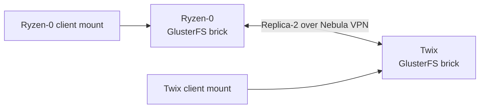

# Storage — GlusterFS

**Project:** Pace University CS371  
**Contributors:** Bayron Arevalo Loja and Justin O'Brien  
**Verified:** November 19, 2026 (UTC)  
**Status:** Operational two-node replicated volume

## Goal

Deploy shared storage across two Linux servers using GlusterFS over a private Nebula VPN. Verify that files written through the mounted volume on either node can be read from the other and are stored on both backing bricks.

## Architecture and design

| Component | Configuration |
|---|---|
| Nodes | Ryzen-0 and Twix (Ryzen-1) |
| Network | Private Nebula VPN |
| Volume | `gv0` |
| Type | Replicate, two bricks (replica 2) |
| Brick path on each node | `/gluster/brick1/data` |
| Client mount on each node | `/mnt/volumes/gv0` |
| Write quorum | Fixed quorum, count 2 |



With fixed write quorum 2, both bricks must be available for normal writes. This design provides replicated storage but not uninterrupted write availability during a node outage.

## Prerequisites

Both Linux hosts need GlusterFS server/client software, a working Nebula connection, a running `glusterd` service, and configured brick and client-mount directories. The original installation transcript was not preserved, so the commands below document **verification of the existing deployment**, not an unverified installation procedure.

On each node:

```bash
sudo systemctl status nebula --no-pager
sudo systemctl status glusterd --no-pager
sudo gluster peer status
sudo gluster volume info gv0
sudo gluster volume status gv0
findmnt -T /mnt/volumes/gv0
```

GlusterFS uses TCP port 24007 for management and dynamically assigned brick ports in this deployment. Permit the necessary peer traffic only within the private network. Do not copy live firewall policies, private keys, or authentication values into documentation.

## Installation and configuration: verified state

The existing `gv0` volume was observed as started, with two bricks and the following settings:

```text
Volume Name: gv0
Type: Replicate
Number of Bricks: 1 x 2 = 2
Status: Started
cluster.quorum-type: fixed
cluster.quorum-count: 2
```

Inspect the live configuration with `sudo gluster volume info gv0`. The brick directory is internal storage managed by GlusterFS; applications should write through `/mnt/volumes/gv0`, **not** directly to `/gluster/brick1/data`.

## Verification

On November 19, 2026 (UTC), the team completed bidirectional client access tests.

**Twix to Ryzen-0:** Twix wrote a file through the client mount:

```bash
echo "Replication verified from Twix $(date)" | sudo tee /mnt/volumes/gv0/final-test-twix.txt
```

Ryzen-0 successfully read it:

```bash
cat /mnt/volumes/gv0/final-test-twix.txt
```

**Ryzen-0 to Twix:** Ryzen-0 wrote another file:

```bash
echo "Replication verified from Ryzen-0 $(date)" | sudo tee /mnt/volumes/gv0/final-test-ryzen0.txt
```

Twix successfully read it:

```bash
cat /mnt/volumes/gv0/final-test-ryzen0.txt
```

**Physical brick verification:** On each node, the team ran:

```bash
sudo ls -l /gluster/brick1/data/final-test-*.txt
```

Both backing bricks contained both test files with matching reported sizes:

| Test file | Size on Ryzen-0 | Size on Twix |
|---|---:|---:|
| `final-test-ryzen0.txt` | 66 bytes | 66 bytes |
| `final-test-twix.txt` | 63 bytes | 63 bytes |

The files were physically present on both servers. File contents were verified across client mounts; no cryptographic hash comparison was performed.

**Healing:** `sudo gluster volume heal gv0 info` reported both bricks connected and **0 pending entries** on each. Both brick processes and both self-heal daemons were online after recovery.

## Troubleshooting and recovery

### Brick offline despite connected peer

During testing, the Twix brick was offline while Ryzen-0's brick remained online. After Nebula connectivity returned, GlusterFS peer status was connected and the management port was reachable, but the Twix brick process exited during startup. The PID file referenced a process that was no longer running.

The team found internal GlusterFS metadata directories with mode `600`, lacking the directory execute/search bit. On the affected Twix node only, the following directories were corrected:

```bash
sudo chmod 700 /gluster/brick1/data/.glusterfs
sudo chmod 700 /gluster/brick1/data/.glusterfs/indices
sudo chmod 700 /gluster/brick1/data/.glusterfs/indices/{dirty,entry-changes,xattrop}
```

Afterward, the team restarted the GlusterFS management daemon **on Twix only**:

```bash
sudo systemctl restart glusterd
sudo gluster peer status
sudo gluster volume status gv0
```

Both bricks then showed online, and healing reported zero pending entries. The exact cause of the earlier brick process exit was not conclusively established; the confirmed recovery sequence was the targeted permission changes followed by the service restart.

### Non-destructive diagnostics

```bash
sudo gluster peer status
sudo gluster volume status gv0
sudo gluster volume heal gv0 info
sudo systemctl status glusterd --no-pager
sudo journalctl -u glusterd -n 50 --no-pager
sudo tail -n 50 /var/log/glusterfs/glusterd.log
sudo tail -n 50 /var/log/glusterfs/bricks/gluster-brick1-data.log
```

Review logs for credentials and identifying details before sharing them. Avoid deleting GlusterFS metadata, recursively changing brick permissions, recreating the volume, or reducing quorum as a troubleshooting shortcut.

## Outcome and limitations

The two-node GlusterFS volume passed bidirectional file-access tests, direct physical-brick file-presence checks, and the self-heal status check. This is evidence of a functioning replicated storage deployment at the verification time, not a complete fault-injection or disaster-recovery test.

Replication is not a replacement for backups. With quorum count 2, a single unavailable node prevents normal writes.

See also [Network Mesh](network-mesh.md) for the private network and [Cloud Infrastructure](cloud-infra.md) for the two-node infrastructure.
